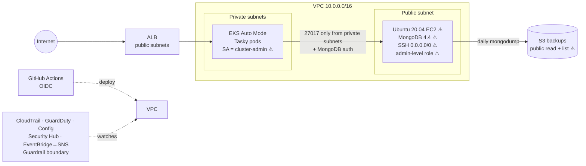

# Wiz Technical Exercise v4 — AWS CloudFormation implementation

A two-tier app (Tasky on EKS → MongoDB on EC2) with the exercise's intentional weaknesses, built entirely with CloudFormation and deployed by GitHub Actions, with a cloud-native security baseline in front of it.



## Intentional weaknesses are preserved, not fixed

Every weakness the exercise requires is deployed as-is. The security controls in this repo **detect** them or **limit blast radius around** them; none removes or remediates one. Remediations belong in your presentation, not in the build.

Run `./scripts/verify-weaknesses.sh` after deploying. It is read-only and proves each weakness is live and each required restriction is in place.

| Required weakness | State in this build | Anything nearby that could look like a fix? |
|---|---|---|
| Outdated Linux | Ubuntu 20.04, auto-patching **disabled** | No |
| SSH open to internet | SG 22 from `0.0.0.0/0`, public EIP | No |
| Overly permissive VM role | `Action: "*"` on `Resource: "*"` — can create VMs, read all S3/secrets | Optional guardrail boundary (`VM_GUARDRAIL_BOUNDARY`, default `true`) denies only disabling logging/detection and creating IAM users. Role is still admin-level and can still create VMs. Set `false` for a completely uncapped role. |
| Outdated MongoDB | 4.4 (EOL), apt-held at that version | No |
| Public read + public list backups | Anonymous `ListBucket` + `GetObject`, over http and https | Encryption at rest (SSE-S3) is transparent to anonymous readers |
| App SA = cluster-admin | `ClusterRoleBinding` to `cluster-admin`, token automounted | Pod hardening (non-root, PSA `restricted` on the `tasky` namespace) doesn't reduce the SA's rights; cluster-admin can create pods in any other namespace |

These are **requirements**, not weaknesses, and are implemented as the exercise states: MongoDB reachable only from the Kubernetes subnets with auth on; cluster in private subnets; Mongo URI via Kubernetes env var.

Extra hardening that is *not* on the weakness list (left on, safe to mention as "things I did right"): IMDSv2 on the VM, encrypted EBS, secrets in Secrets Manager, immutable image tags.

Upstream image vulnerabilities: the Dockerfile upgrades Tasky's old dependencies (`PATCH_DEPS=true`) so the Trivy gate passes. If you want vulnerable packages to show in the demo, build with `PATCH_DEPS=false` and set `TRIVY_ENFORCE=false`. The gate will then report instead of block — say so explicitly as a documented exception.

## Repository layout

| Path | Purpose |
|---|---|
| `cloudformation/00-github-oidc.yaml` | Bootstrap (deploy once by hand): GitHub OIDC provider + deploy role |
| `cloudformation/01-network.yaml` | VPC, 2 public + 2 private subnets, NAT, VPC Flow Logs |
| `cloudformation/02-security-baseline.yaml` | CloudTrail, GuardDuty, Config rules, Security Hub, alerting, guardrail boundary |
| `cloudformation/03-mongodb-vm.yaml` | MongoDB VM, secrets, daily backup job, public backup bucket |
| `cloudformation/04-eks.yaml` | EKS Auto Mode cluster (private subnets) + ECR |
| `k8s/` | Namespace (Pod Security `restricted`), RBAC, IngressClass, Deployment, Service, Ingress |
| `app/` | Dockerfile, `wizexercise.txt`; Tasky source is vendored into `app/src` |
| `policies/guard/` | cfn-guard rules — hard pipeline gate |
| `.github/workflows/` | `iac.yml`, `app.yml`, `teardown.yml` (all actions pinned to commit SHAs) |
| `scripts/` | `preflight.sh` (first thing after access), `vendor-tasky.sh`, `verify-weaknesses.sh` (pre-demo check), `demo.sh` (live walkthrough), `attack-sim.sh`, `teardown.sh` |

## Requirement traceability

| Exercise requirement | Where | How to prove it live |
|---|---|---|
| VM on 1+ year outdated Linux | `03` — Ubuntu 20.04 AMI, unattended-upgrades disabled | `demo.sh` step 6 (`lsb_release`) |
| SSH exposed to internet | `03` — SG 22 from `0.0.0.0/0` | `demo.sh` step 8 |
| VM overly permissive CSP perms (create VMs) | `03` — `Action: "*"` managed policy | `attack-sim.sh` A3 (`run-instances --dry-run`) |
| MongoDB 1+ year outdated | `03` — 4.4 (EOL Feb 2024), version held | `demo.sh` step 6 |
| Mongo restricted to K8s network + auth | `03` — SG 27017 from private subnet CIDRs only; `authorization: enabled` | `demo.sh` step 8 (27017 closed from internet) |
| Daily automated backup to object storage | `03` — cron `0 2 * * *` → `mongodump` → S3 | `demo.sh` step 7 |
| Bucket public read + public list | `03` — bucket policy `Principal: "*"` | `attack-sim.sh` A1 (anonymous curl) |
| K8s cluster in private subnet | `04` — cluster `SubnetIds` are private only | `kubectl get nodes -o wide` (no external IPs) |
| Mongo access via K8s env var | `k8s/30-deployment.yaml` — `MONGODB_URI` from Secret | `demo.sh` step 3 |
| `wizexercise.txt` with your name | `app/Dockerfile` `COPY wizexercise.txt` | CI step + `kubectl exec … cat /app/wizexercise.txt` |
| Cluster-wide admin role for app | `k8s/10-rbac.yaml` — ClusterRoleBinding to `cluster-admin` | `attack-sim.sh` A4 |
| Ingress + CSP load balancer | `k8s/20-*`, `k8s/50-*` — EKS Auto Mode ALB | `demo.sh` step 4 |
| kubectl demo; data in DB | — | `demo.sh` steps 1 and 5 |
| VCS + 2 pipelines (IaC, app) | `.github/workflows/iac.yml`, `app.yml` | GitHub Actions tab |
| Repo + IaC + image scanning | branch rules, secret scanning, cfn-lint, cfn-guard, Checkov, hadolint, Trivy | GitHub Security tab |
| Control plane audit logging | `02` — CloudTrail; `04` — EKS api/audit/authenticator logs | `demo.sh` step 9 |
| ≥1 preventative control | Guardrail permissions boundary; Pod Security Admission; cfn-guard gate; Trivy gate | `attack-sim.sh` A3, P1 |
| ≥1 detective control | GuardDuty, Config rules, Security Hub, EventBridge→SNS | `demo.sh` step 10, `attack-sim.sh` D1 |

## Deployment — step by step

Total hands-on time is about 1.5 hours, most of it waiting (EKS takes ~15 minutes). Phase 0 can be done today; everything from Phase 1 onward needs the AWS account.

### Phase 0 — Before you have AWS access

**0.1 Install tools.** You need AWS CLI v2, git, jq, kubectl, ssh, nc, and curl. AWS CloudShell already has most of these and works if CloudLabs only gives console access.

**0.2 Create the GitHub repository.** Making it **public** is recommended, and it's free. Public repos get environments with required reviewers, rulesets, secret-scanning push protection, and code scanning (the Security tab). On a free *private* repo, approvals and the Security tab aren't available. The pipelines still run, but you lose two of your best demo screens. Nothing secret is ever committed. Still, ask your hiring manager if a public repo is fine.

**0.3 Prepare the code.**

```bash
unzip wiz-exercise.zip && cd wiz-exercise
./scripts/vendor-tasky.sh                                  # pulls Tasky @ pinned commit into app/src
echo "Your Full Name" > app/wizexercise.txt                # pipeline refuses to build without this
sed -i 's/YOUR_GITHUB_USERNAME/<your-github-handle>/' .github/CODEOWNERS   # macOS: sed -i ''
git init -b main && git add . && git commit -m "Wiz technical exercise"
git remote add origin https://github.com/<org>/<repo>.git
```

**Do not push yet.** Pushing triggers the pipelines, and they need AWS set up first.

### Phase 1 — Get into the AWS account

**1.1 Redeem the CloudLabs voucher.** Note the account ID, which **region(s)** you're allowed to use, and the **lab expiry time** (some labs wipe the account when it expires).

**1.2 Get CLI credentials.** Export the access keys CloudLabs gives you, or open CloudShell from the console.

```bash
export AWS_REGION=us-east-1          # use us-east-1 unless the lab restricts it
aws sts get-caller-identity          # must succeed
```

### Phase 2 — Preflight (fills most of the gaps for you)

```bash
AWS_REGION=$AWS_REGION GITHUB_ORG=<org> GITHUB_REPO=<repo> ./scripts/preflight.sh
```

The script is read-only. It checks:
- account-level S3 Block Public Access
- whether GuardDuty, AWS Config, Security Hub, or the GitHub OIDC provider already exist (each can exist only once per region)
- the Ubuntu 20.04 AMI
- Elastic IP and VPC quotas
- your permissions

It ends by printing the **exact bootstrap command and GitHub variable values** to use. Fix every `[BLOCKER]` and read every `[ACTION]` before continuing.

The most common action is account-level Block Public Access being on. That blocks the required public bucket:

```bash
aws s3control delete-public-access-block --account-id <ACCOUNT_ID>
```

### Phase 3 — Bootstrap the pipeline identity (one time, from your terminal)

**3.1 Deploy the bootstrap stack.** Run the bootstrap command preflight printed. It looks like this:

```bash
aws cloudformation deploy --region us-east-1 --stack-name wiz-github-oidc \
  --template-file cloudformation/00-github-oidc.yaml --capabilities CAPABILITY_NAMED_IAM \
  --parameter-overrides ProjectName=wiz GitHubOrg=<org> GitHubRepo=<repo> CreateOidcProvider=true
```

**3.2 Copy the role ARN.**

```bash
aws cloudformation describe-stacks --stack-name wiz-github-oidc \
  --query "Stacks[0].Outputs[?OutputKey=='DeployRoleArn'].OutputValue" --output text
```

`GitHubOrg` and `GitHubRepo` must match the GitHub URL exactly, including case. A mismatch shows up later as `Not authorized to perform sts:AssumeRoleWithWebIdentity`.

### Phase 4 — Configure GitHub (these are also your "VCS security controls")

**4.1 Create the environment.** Go to Settings → Environments → New environment and name it **`production`** (exactly this name; the AWS role only trusts it). Then:
- Add yourself under **Required reviewers**.
- Set **Deployment branches** to `main` only.
- Add the environment secret **`AWS_DEPLOY_ROLE_ARN`** = the ARN from step 3.2.

**4.2 Add repository variables.** Go to Settings → Secrets and variables → Actions → Variables. Paste the values preflight printed:

| Variable | Value |
|---|---|
| `AWS_REGION` | your region |
| `PROJECT_NAME` | `wiz` |
| `EKS_ADMIN_PRINCIPAL_ARN` | from preflight. This is what lets *your* kubectl in. |
| `CREATE_GUARDDUTY` / `CREATE_CONFIG_RECORDER` / `ENABLE_SECURITY_HUB` | from preflight |
| `ALERT_EMAIL` | optional, for alert emails |
| `MONGO_VERSION` | leave unset (4.4). Only set it if the 4.4 install fails. |
| `VM_GUARDRAIL_BOUNDARY` | leave unset (`true`), or `false` for a fully uncapped VM role |

**4.3 Protect `main`.** Go to Settings → Rules → New branch ruleset, target `main`, and enable:
- block force pushes
- require a pull request
- require status checks `scan` and `build-scan` (these appear after the first run, so add them then)

**4.4 Turn on code security.** Go to Settings → Code security and enable:
- secret scanning with push protection
- Dependabot alerts
- CodeQL default setup

### Phase 5 — Deploy the infrastructure

**5.1 Push.**

```bash
git push -u origin main
```

**5.2 Approve the IaC deployment.** In the Actions tab, open the **iac** run. When it says *Waiting for review*, click **Review deployments → Approve**. The stacks deploy in this order:
- network (~3 min)
- security (~3 min)
- mongodb (~3 min)
- eks (~15 min)

**5.3 Ignore the first app run.** The **app** workflow also starts on this first push. Its deploy job fails with "Stack wiz-eks not found", or you can reject its approval. That's expected. It re-runs automatically when **iac** succeeds; approve that second run.

**5.4 Wait for MongoDB setup.** The VM finishes installing MongoDB about 5 minutes *after* its stack completes. If Tasky pods restart a few times early on, that's why, and they recover on their own.

### Phase 6 — Verify and seed data

**6.1 Point kubectl at the cluster.**

```bash
aws eks update-kubeconfig --region $AWS_REGION --name wiz-eks
kubectl get nodes -o wide && kubectl -n tasky get pods,ingress
```

**6.2 Open the app.** The URL is in the app run's summary, or in `kubectl -n tasky get ingress`. Sign up and add a few todos.

**6.3 Refresh the backup.** The first backup ran at VM boot, before any app data existed. Take a fresh one so the public bucket has real data for the demo:

```bash
aws ssm send-command --instance-ids $(aws cloudformation describe-stacks --stack-name wiz-mongodb \
  --query "Stacks[0].Outputs[?OutputKey=='MongoInstanceId'].OutputValue" --output text) \
  --document-name AWS-RunShellScript --parameters 'commands=["/usr/local/bin/mongo-backup.sh"]'
```

**6.4 Prove every requirement is live.**

```bash
./scripts/verify-weaknesses.sh      # must end with 0 FAIL
```

**6.5 Confirm alerts.** If you set `ALERT_EMAIL`, click the confirmation link in the SNS email.

**6.6 Let the detective controls populate.** Leave the environment running for at least 1 hour before the demo. GuardDuty findings, Config evaluations and Security Hub scores need that time.

### Phase 7 — Rehearse and manage lab time

**7.1 Rehearse.** Run `./scripts/demo.sh` and `./scripts/attack-sim.sh` end to end at least once.

**7.2 Tear down between sessions if the lab allows it.** Use Actions → **teardown** (type `DESTROY`). Rebuilding is just re-running **iac**. If the lab has a hard expiry, plan the rebuild so it finishes ≥ 1 hour before the panel.

## Gaps to fill once you have access

`preflight.sh` answers most of these automatically. The rest need a human answer.

| # | Gap | Why it matters | How to resolve |
|---|---|---|---|
| 1 | **Allowed region** | Everything is regional. IAM tampering alerts only fire in us-east-1. | CloudLabs details. Prefer `us-east-1`. |
| 2 | **Lab expiry / auto-wipe** | Decides when you build before the panel | CloudLabs details or recruiter |
| 3 | **Account-level S3 Block Public Access** | If on, the required public bucket fails to deploy | preflight; turn off if permitted, otherwise raise with hiring manager |
| 4 | **Existing GuardDuty / Config / Security Hub / OIDC provider** | Only one per region; duplicates fail the stack | preflight → GitHub variables / `CreateOidcProvider` |
| 5 | **Your IAM principal ARN** | Without it, your laptop's kubectl is unauthorized | preflight → `EKS_ADMIN_PRINCIPAL_ARN` |
| 6 | **Service Control Policies (SCPs)** | A sandbox may deny services/instance types; preflight can't see SCPs | Only the first deploy proves it; `describe-events` shows `explicit deny in a service control policy` |
| 7 | **Ubuntu 20.04 AMI availability** | Needed for the "outdated OS" requirement | preflight; otherwise pass a literal AMI id as `MongoAmiId` |
| 8 | **MongoDB 4.4 apt key validity** | Key has lapsed before; can't be checked until the VM boots | `/var/log/user-data.log`; fallback `MONGO_VERSION=5.0` |
| 9 | **Public vs private GitHub repo** | Private free repos lose approvals and the Security tab | Ask hiring manager; public recommended |
| 10 | **Your name, GitHub handle, alert email** | `wizexercise.txt`, `CODEOWNERS`, SNS | Phase 0.3 / 4.2 |
| 11 | **Port 22 from your network** | Corporate networks often block outbound SSH, which breaks `demo.sh` SSH steps | Test `nc -z <ip> 22`; else use CloudShell or a hotspot |
| 12 | **Tasky Go build** | Not compiled outside CI. Upgrading the old dependencies is the most likely first failure. | First app run. If it fails, set `PATCH_DEPS=false` in the Dockerfile and `TRIVY_ENFORCE=false`. Present that as a documented exception. |

## Intentional weaknesses: consequence and control

| # | Weakness | Realistic consequence | Prevented / detected by |
|---|---|---|---|
| W1 | EOL Ubuntu 20.04, patching off | Unpatched kernel/OpenSSH CVEs → RCE | Inspector/Security Hub, GuardDuty Runtime |
| W2 | SSH open to `0.0.0.0/0` | Brute force, exploit of outdated sshd | Config `INCOMING_SSH_DISABLED`, GuardDuty `SSHBruteForce` |
| W3 | Admin-level VM role | VM compromise = account compromise: launch miners, read all data | Optional boundary limits blast radius (can't disable CloudTrail/GuardDuty/Config or plant IAM users); Config admin-access rules; EventBridge tampering alerts |
| W4 | MongoDB 4.4 (EOL) | Unpatched DB CVEs | Inventory via SSM/Inspector |
| W5 | Public read+list backups | Anyone downloads the full DB incl. password hashes | Config S3 public-read rule, Security Hub, CloudTrail S3 data events record each anonymous read |
| K1 | App SA bound to `cluster-admin` | App RCE → read every Secret, run anything in the cluster | EKS audit logs, GuardDuty EKS protection; Pod Security still blocks privileged pods |
| K2 | Tasky logs its full `MONGODB_URI` | DB password in plaintext container logs | Found during review — talk about it as a finding |

Worth stating in the presentation: the chain W2→W1→W3 is the critical path (internet → shell → admin cloud identity), and the boundary is what turns "full account takeover" into "loud, logged, partial compromise". A scanner flags each item separately; context (exposure + identity + data) is what makes it a critical *path*.

## Suggested 45-minute flow

1. Slides (10 min): architecture, approach, why CloudFormation + EKS Auto Mode, pipeline design, challenges.
0. Before the call: `./scripts/verify-weaknesses.sh` must report 0 FAIL.
2. Live (20 min): `./scripts/demo.sh` → walk each requirement; open the Actions and Security tabs.
3. Live (10 min): `./scripts/attack-sim.sh` → each weakness, its consequence, the control that fired.
4. Wrap (5 min): what you would fix first and how (see table above).

## Challenges worth discussing (true of this design)

- **EKS Auto Mode** removes the Load Balancer Controller install and node groups, but configures ALBs via `IngressClassParams` and creates the node access entry itself (creating it in CloudFormation conflicts).
- **Secure defaults vs. required weaknesses**: the security stack's cfn-guard rules are a hard gate; the weaknesses are surfaced by Checkov in soft-fail mode so they stay visible instead of suppressed. The only suppression is a documented Checkov false positive on the boundary policy.
- **Secrets**: generated by Secrets Manager, read by the VM at boot and by the pipeline to build the K8s Secret; never in parameters, user data or Git.
- **Teardown order**: the Ingress's ALB isn't CloudFormation-managed and blocks VPC deletion, hence `teardown.sh` deletes it first.

## Teardown

Actions → **teardown** → type `DESTROY`, or run `PROJECT=wiz AWS_REGION=… ./scripts/teardown.sh`. CloudTrail and Config buckets are retained on purpose (audit evidence). Delete `wiz-github-oidc` last. EKS, Auto Mode, NAT and ALB bill hourly — tear down between sessions.

## Troubleshooting

| Symptom | Fix |
|---|---|
| `03-mongodb` OK but app can't connect | SSH in, `tail /var/log/user-data.log`. `EXPKEYSIG` from the MongoDB repo means its signing key lapsed: set `MONGO_VERSION` to `5.0` or `6.0` (also EOL) and redeploy. |
| AMI parameter not found | Pass a literal Ubuntu 20.04 AMI id as `MongoAmiId`. |
| Backup bucket policy `AccessDenied` | Account-level S3 Block Public Access is on (step 2). |
| `AlreadyExists` for GuardDuty/Config/Security Hub | Set the matching variable to `false`. |
| `kubectl` says unauthorized from your laptop | Set `EKS_ADMIN_PRINCIPAL_ARN` (role ARN, not session) and redeploy `iac`. |
| Trivy gate fails | That's the control working. Read the table, bump the dependency in the Dockerfile `PATCH_DEPS` step; `TRIVY_ENFORCE=false` only as a documented exception. |
| `Not authorized to perform sts:AssumeRoleWithWebIdentity` | `GitHubOrg`/`GitHubRepo` in the bootstrap stack don't match the repo exactly, or the job isn't using the `production` environment. |
| `explicit deny in a service control policy` | The CloudLabs sandbox blocks that service or setting. Note which resource, then ask the hiring manager. |
| App run fails: `Stack wiz-eks not found` | Expected on the first push; it re-runs after `iac` succeeds. |
| Stack fails | `aws cloudformation describe-events --stack-name <stack>` to find the first failing resource. |
