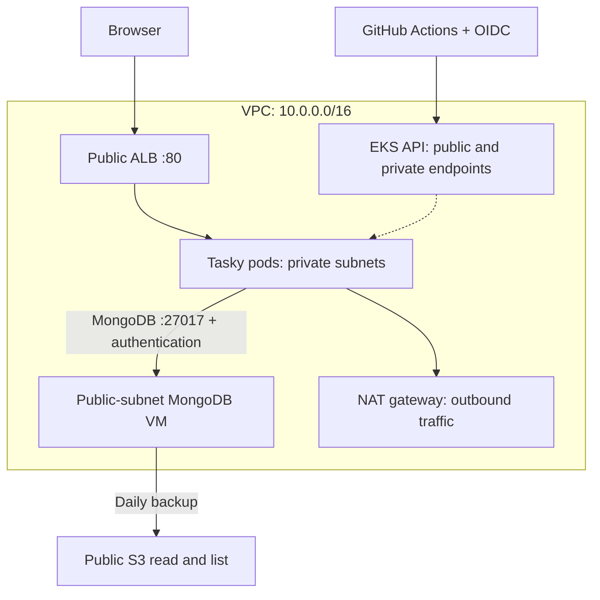

# Wiz exercise: evidence review and rehearsal guide

Reviewed 28 October 2026 against `main` commit `23bd7eedc12e4a00d21d7a19f61f3dfdbcfad28e`.
This document describes proposed changes on the review branch unless explicitly labelled as existing evidence.

## What is established

The repository implements Tasky (Go) on EKS Auto Mode, MongoDB 4.4 on an Ubuntu 20.04 EC2 VM, CloudFormation, public backup read/list, and cloud-native security services. This supersedes the earlier proposed Flask/MongoDB 6.0/managed-node-group design.

GitHub records successful infrastructure run [40581508033](https://github.com/shewaramanikriti/wiz-exercise/actions/runs/40581508033) and application run [40582076822](https://github.com/shewaramanikriti/wiz-exercise/actions/runs/40582076822), both for commit `9bc0f7cae7efac9fa24e7b60fef08eca28968136`. The application jobs include image build, Trivy gate, ECR push, rollout, and `wizexercise.txt` verification. These are dated deployment evidence, not a fresh health check.

The `protect-main` ruleset is active. It requires both named CI checks and a PR, blocks force pushes/deletion, allows administrator bypass, and requires **zero approving reviews**. CODEOWNERS alone does not enforce a second-person review. Deployment approval is a separate control. Both required workflows now run on every PR so a path filter cannot leave a required check permanently pending.

No direct AWS or Kubernetes reads were completed from the review environment. Its AWS endpoint connection timed out. Do not describe the review as a fresh live deployment verification.

## The architecture you should be able to explain



The private subnets are `10.0.16.0/20` and `10.0.32.0/20`. The public subnets are `10.0.0.0/24` and `10.0.1.0/24`. The ALB reaches pod IPs; the NAT gateway serves outbound traffic and is not in the incoming browser request path. The database has a public IP for the required SSH exposure, but its MongoDB port admits only the two private CIDRs.

This CIDR control trusts any workload in those subnets. It is not a per-pod or per-service identity policy. A production design would narrow network identity and retain database authorization.

## Findings and what this branch changes

| Finding | Consequence | Proposed change / remaining work |
|---|---|---|
| The app prints its MongoDB URI | Anyone with pod-log access can obtain the database password | Remove the URI and use generic initialization errors. Say "client configured" because driver connection is lazy. Rotate the exposed lab password after a coordinated MongoDB, Secrets Manager and Kubernetes update; changing only Secrets Manager breaks authentication. Historical logs remain historical exposure. |
| Verification negates an empty `kubectl` result | An API failure or an empty cluster can appear to prove private nodes | Require successful JSON reads, at least one Ready node, matching EC2 instances, private-subnet membership and no public IPs. Inspect all attached database SGs. Check the current IAM policy version, not hard-coded `v1`. |
| Same-commit reruns reuse an existing image | A new scan may not cover the image that is actually deployed | Publish the scanned archive under a commit/run/attempt tag; validate the archive checksum; deploy the ECR digest. A workflow-run build checks out the triggering infrastructure run's commit. |
| ALB wait prints success after timeout | Deployment can claim a live app with an empty hostname | Fail unless a hostname and successful frontend HTTP response appear. A separate database round trip is still required. |
| Demo tries real StopLogging/DeleteDetector/CreateUser operations | A missing or changed boundary can make the supposed denial demonstration destructive | Use IAM policy simulation, labelled honestly as simulation. Use server-side dry run for the Pod Security demonstration. No Secret values are retrieved to prove cluster-admin. |
| HTTP was allowed to preserve public backups | Extra transport exposure without any assignment benefit | Restore HTTPS-only access. Anonymous HTTPS ListBucket/GetObject remain allowed. This is a preventative control independent of authentication. |

The intentionally old OS/database, public SSH, excessive VM permissions, public backup read/list, and cluster-admin application service account remain represented. Proposed checks do not remediate those exercise requirements.

## Claims to correct before presenting

1. **Private nodes are not a private API.** `EndpointPublicAccess` and `EndpointPrivateAccess` are both true. Public API access is `0.0.0.0/0` by default, with IAM and Kubernetes authorization. This allows GitHub-hosted runners to deploy. A private API would need a runner with VPC connectivity or another controlled deployment path.
2. **The boundary demonstrates selected denies, not complete containment.** It denies StopLogging and several other listed actions, but does not deny, for example, `eks:UpdateClusterConfig` (which can change EKS logging), `events:DisableRule`, or `sns:Unsubscribe`. Those remain allowed by the VM's broad identity policy and the boundary's Allow-all, subject to other account controls. Do not claim a compromised VM cannot disrupt detection or take over the account.
3. **Namespace Pod Security is not a boundary against cluster-admin.** It rejects nonconforming Pod specifications in `tasky`. The application service account can change namespace labels or use another namespace. Describe the demonstrated admission control and the residual RBAC risk separately.
4. **Ubuntu 20.04 is outside standard support, not universally unsupported.** Standard maintenance ended in May 2025; Ubuntu Pro/ESM can extend coverage. Check `pro status` and actual installed packages before making patch-specific claims. A currently published 20.04 AMI can have newer packages. MongoDB 4.4's published EOL is 29 February 2024.
5. **Enabled is not covered.** Verify GuardDuty runtime coverage and supported agent/platform versions for the actual cluster. The walkthrough records Kubernetes 1.37, but the template leaves the version at the EKS default. Read the running version; do not infer it from the template. Inspector is not provisioned by this repository.
6. **Sample findings prove the alert path.** They do not prove that GuardDuty detected your actual banner lookup, Secret access or public download. Config findings prove a posture condition, not that a specific exploit occurred.
7. **CloudTrail is not an audit of every action everywhere.** This trail selects management events plus matching S3 data events. Kubernetes API calls belong in EKS audit logs. CloudTrail Event history omits data events; use delivered trail logs to prove a particular download/list operation. CloudTrail Lake is not provisioned here.
8. **A green scan is scoped.** Checkov reports without blocking. Trivy's gate blocks fixable CRITICAL findings; HIGH findings and unfixed CRITICAL findings do not fail that gate. `TRIVY_ENFORCE=false` bypasses it. Neither tool proves the absence of application logic flaws.
9. **Builds are not fully reproducible yet.** `go get ...@latest`, mutable base-image tags and `apk upgrade` can change the binary for the same commit. The digest change binds deployment to this run's scan, but does not pin all inputs. Follow up with reviewed `go.mod/go.sum` upgrades and base-image digests.
10. **Two replicas do not establish high availability.** Check actual placement. There is one database VM and one NAT gateway; no database replica set or tested automatic recovery is declared.

## Additional application findings to track

Source inspection found application authorization flaws beyond the requested infrastructure weaknesses. `GetTodo` has no session check. Other todo handlers accept a user ID supplied in a URL/body without matching it to the verified JWT identity. Several filters use `userid`, while the model stores `user_id`, which also requires correction and regression tests. Treat these as an explicit application-security backlog, not evidence that the app is production-ready. Use only synthetic demo accounts and todos.

Other follow-ups: validate signup/login fields before pointer dereferences; return on malformed JWT parse errors; fix the frontend's stringification of `response.json()` promises; use appropriate cookie settings with HTTPS; make readiness prove usable database access; separate application and backup database users. These are not fixed by the focused changes above.

## Verification after review and deployment

Run from a terminal already configured for the lab account. Never paste access keys or database passwords into chat or a repository.

```bash
export AWS_REGION=us-east-1
aws sts get-caller-identity
aws eks describe-cluster --name wiz-eks \
  --query 'cluster.{status:status,version:version,public:resourcesVpcConfig.endpointPublicAccess,private:resourcesVpcConfig.endpointPrivateAccess,cidrs:resourcesVpcConfig.publicAccessCidrs}'
aws eks update-kubeconfig --name wiz-eks --region "$AWS_REGION"
kubectl get nodes -o wide
kubectl -n tasky get deploy,pods,svc,ingress -o wide
./scripts/verify-weaknesses.sh
```

`verify-weaknesses.sh` performs read-only cloud checks and writes temporary local files/kubeconfig. A successful result does not prove every control or the full application flow. Capture the time, account, commit, image digest and commands with each evidence set.

Then perform these checks, in order:

1. Create a uniquely named synthetic todo through the ALB. Query that exact record in MongoDB. Delete/reload only the synthetic test record to verify actual persistence and ownership behavior.
2. Confirm a recent scheduled backup and perform an isolated restore to a temporary database. A file in S3 is not proof of recoverability. Never restore over the live application database.
3. Make an unsigned HTTPS list/download and record its HTTP status. Check the equivalent HTTP request is denied after the proposed TLS policy is deployed. Keep the dump private locally and delete it after checking.
4. Use a server-side dry run to demonstrate Pod Security rejection. Record the actual admission message. Policy simulation provides a second, clearly labelled control demonstration.
5. Show a real Config NON_COMPLIANT finding for the public bucket and a real EKS audit event. If showing a GuardDuty sample, label it SAMPLE and show delivery to the configured destination separately.
6. Verify the running image ID matches the release digest. Rehearse cleanup on the actual resource inventory: retained/versioned S3 objects, ECR, Auto Mode resources, ALBs and security-service dependencies can survive or delay stack deletion. Do not assume stack deletion means zero cost.

## A focused 15-minute opening

| Time | Show | Explain |
|---|---|---|
| 0-2 min | Requirements and architecture | What is intentionally insecure; what is required to remain restricted. |
| 2-5 min | One browser request and matching DB record | ALB to pod to database; where authentication and networking apply. |
| 5-7 min | Running name file and RBAC permission check | Image identity; why non-root is different from Kubernetes cluster-admin. |
| 7-10 min | One preventative control and one real finding | Exact evidence, scope, residual risk and business impact. |
| 10-12 min | The two pipelines | OIDC, scan coverage, approval, artifact provenance and digest deployment. |
| 12-15 min | Two debugging stories and priorities | Symptom, evidence, cause, code fix, verification; then production changes. |

Keep backup material for the questions. Lead with a confirmed path to impact, such as anonymous backup access to synthetic database data. An SSH banner plus an old OS suggests exposure; it is not proof of remote code execution. You do not need to perform exploitation to explain the risk.

Suggested explanation of AI use: "I used AI to draft code and accelerate research. I am responsible for the design, requirement mapping, deployment and verification. Here is a decision I changed after testing, and the evidence behind it." Adapt this to what you actually did.

## Sources checked for this review

- [EKS API endpoint access](https://docs.aws.amazon.com/eks/latest/userguide/cluster-endpoint.html)
- [IAM permissions boundaries](https://docs.aws.amazon.com/IAM/latest/UserGuide/access_policies_boundaries.html)
- [S3 policy examples: public access and HTTPS](https://docs.aws.amazon.com/AmazonS3/latest/userguide/example-bucket-policies.html)
- [CloudTrail S3 events and data-event visibility](https://docs.aws.amazon.com/AmazonS3/latest/userguide/cloudtrail-logging-s3-info.html)
- [Kubernetes Pod Security Admission](https://kubernetes.io/docs/concepts/security/pod-security-admission/)
- [GuardDuty EKS runtime prerequisites](https://docs.aws.amazon.com/guardduty/latest/ug/prereq-runtime-monitoring-eks-support.html)
- [Ubuntu security-maintenance schedule](https://ubuntu.com/security/esm)
- [MongoDB lifecycle schedule](https://www.mongodb.com/legal/support-policy/lifecycles)

Reasoning is documented as decisions, evidence and trade-offs. Unverified live state is labelled rather than inferred from a diagram or a successful build.
